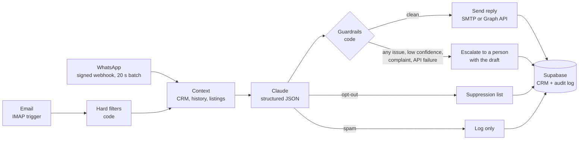
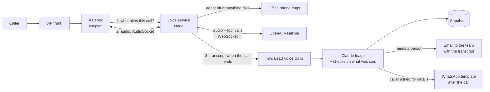

# AI lead agent for an estate agency: email, WhatsApp and phone (n8n + Claude + Supabase)

An AI agent that answers an estate agency's inbound email, WhatsApp messages and phone calls. It works out who the person is and what they want, answers from the agency's live listings, saves the lead to the CRM, and hands anything risky to a person with a draft or a transcript attached.

This is an extract of a system I built for an estate agency in South Africa. The production system also checks the documents clients send and tracks purchases through to handover; those parts are left out here. The agency's name, people, listings and contact details have been replaced with fictional ones ("Harbour Key Properties").

## The business problem

A small agency gets enquiries at all hours, by email, by phone and on WhatsApp: buyers, tenants, sellers, bond questions, complaints, spam. Answering them was manual, so replies were slow outside office hours, lead details stayed in the inbox instead of the CRM, and nobody had an overview of what had come in.

Estate agency is also regulated. An automated reply that quotes a bond rate, promises someone will qualify, invents a price, or answers a legal complaint creates real liability. So the brief was not "have an AI answer the customers". It was: answer the routine enquiries well on every channel, and make it impossible for the risky ones to go out unseen.

## What it does

| Workflow | Trigger | What happens |
|---|---|---|
| **Lead Email Agent** | New mail in the mailbox (IMAP) | Filters out bounces, auto-replies and newsletters. Loads the contact, their conversation history and the live listings from Supabase. Claude classifies the email, extracts the lead details and drafts a reply as structured JSON. Code-level checks then **send** it, **escalate** it to a person, record an **opt-out**, or drop **spam**. Everything is logged. |
| **Lead WhatsApp Agent** | Meta's WhatsApp Cloud API webhook | Checks Meta's signature on the raw body, logs each message, then waits 20 seconds so a burst ("Hi" plus three more lines) gets one reply. The same prompt, guardrails and decision as email, with its own kill switch and reply limit. Replies go back through the Graph API, and forms arrive in the chat as a PDF. |
| **Lead WhatsApp Transcripts** | Every 15 minutes | Nobody at the office watches the WhatsApp number, so each conversation is emailed to the team once it has been quiet for two hours. |
| **Lead Voice Calls** | A finished phone call (internal webhook) | The voice agent (below) posts each call's transcript. Claude triages it: who called, what they want, whether someone must phone back. The code also checks what the agent *said* against the same rules as a written reply, and emails the team the transcript when anything needs a person. |
| **Lead Website Form** | `POST /webhook/website-enquiry` | The website's contact form and chat widget post here. The enquiry is emailed to the office and the contact is created in the CRM, so the agent already knows them when they write. |
| **Lead Daily Digest** | 07:30 every day | Emails the team the last 24 hours: new enquiries with what is still missing, what needed a person, opt-outs and the spam count. |
| **Lead Error Alert** | Any workflow fails | Emails the person responsible. |

All three channels write to the same contact and the same event log, so a WhatsApp reply knows about yesterday's phone call and last week's email.

## How a reply is decided



The design rule is that **the model drafts and the code decides**:

- **The model never sends anything.** It returns JSON matching [`prompts/email-agent.schema.json`](prompts/email-agent.schema.json). The code only ever replies to the address or number the message came from, and can only attach files listed in [`forms/catalog.json`](forms/catalog.json) (the schema's `attach` field is an enum built from that file).
- **Guardrails run in code on every draft** ([`guardrails()` in `n8n/code/lib.js`](n8n/code/lib.js)). A draft is held for a person if it contains:
  - bond rates, repayments, or a claim that someone will qualify
  - transfer or conveyancing costs, yields, commission, guarantees, percentages
  - a Rand amount that is not in a listing or the customer's own message
  - a date the customer did not give
  - a link outside the allowlist, or an email address that is not theirs or ours
  - an unfilled placeholder, or text that disagrees with the attachments ("attached" with nothing attached)
  - or if that person has already had three automatic replies in 24 hours (ten on WhatsApp)
- **Always escalated:** regulator mentions, complaints, attorney letters, data-access requests, banking-detail changes, low confidence, any failed or refused model call, and anything the agent cannot open (a photo, a document, a voice note). The customer gets a short holding reply, except for suspected prompt injection, which gets no reply.
- **Customer text is data.** The message is wrapped in `<email>`, `<whatsapp>` or `<call>` tags and the prompt tells the model to treat it as text from a member of the public. The guardrails are the actual control: an injected instruction still cannot produce a link, an address, a price or an attachment that the code will send.
- **Facts the model gets wrong are computed in code.** The model once told a buyer nothing was within budget while quoting a home well under it. The prompt now carries a "price check" block worked out by [`priceCheckBlock()`](n8n/code/lib.js), so that comparison is no longer the model's job.
- **A kill switch per channel.** `AGENT_AUTO_SEND=false` (email), `AGENT_WA_AUTO_SEND=false` (WhatsApp) and `AGENT_VOICE_ENABLED=false` (phone) each turn that channel back into "a person handles it": drafts go to the team for review, and calls ring the office. The production rollout started on a test mailbox, and the voice agent can be limited to a list of test numbers while it stays off for everyone else.
- **No loops, no repeats.** Outgoing mail carries RFC 3834 `Auto-Submitted` headers, incoming auto-replies are filtered before any model call, and a message or call already logged is never handled twice (Meta retries webhooks).

## The voice agent



[`voice/`](voice) is a small Node service next to n8n with no dependencies. Asterisk takes the call from the SIP trunk and asks the service who should take it ([`server/asterisk/extensions.conf`](server/asterisk/extensions.conf)). If the agent is off, the caller has opted out, Supabase is down or OpenAI does not answer, the office phone rings instead: **every failure ends with a person answering**. Otherwise Asterisk streams the call's audio over AudioSocket, and the service relays it to OpenAI's Realtime model with the same rules as the written channels plus spoken ones ([`prompts/voice-agent.system.md`](prompts/voice-agent.system.md)).

- **Three tools, nothing else:** `take_message`, `end_call`, and `send_whatsapp` (only once Meta has approved the message template). The agent cannot transfer money, book anything or look anything up beyond the listings in its instructions.
- **It behaves like a person on a phone:** the caller can talk over it (playback stops and the model is told how much was actually heard), it checks in after silence and then hangs up, and it wraps up at a time limit.
- **Caller ID can be faked,** so it never discusses a transaction on the phone. It takes a message and the team phones back.
- **The call is checked after the fact.** The live model cannot be held to a JSON schema, so when the call ends the transcript goes to n8n, where Claude triages it and [`voiceIssues()`](n8n/code/lib.js) applies the written guardrails to the agent's side of the conversation. If it quoted a rate or an amount that is not in a listing, the team gets an email with the transcript.
- **The WhatsApp a caller asks for** is written by Claude, checked by the same guardrails, and sent as an approved template, since a business may not start a WhatsApp chat with free text.

## Tools and integrations

| | |
|---|---|
| **n8n** (self-hosted, Docker) | Triggers, webhooks, scheduling, retries, the error workflow, execution history |
| **Claude API** (Haiku) | Classification, extraction and drafting in one call, with structured outputs (JSON schema) and prompt caching for the system prompt and listings. Also triages finished calls |
| **Supabase** (Postgres, REST, Storage) | CRM: contacts, an append-only event log, listings, opt-out suppression list. Row-level security on, service role only. Storage holds the forms Meta fetches through a one-hour signed link |
| **IMAP / SMTP** | Reads and replies from the agency's existing mailbox, threaded into the customer's conversation |
| **WhatsApp Cloud API** (Meta Graph API) | Signed webhooks in, text, documents and an approved template out |
| **Asterisk** (SIP trunk, AudioSocket) | Takes the phone call and streams its audio to the voice service |
| **OpenAI Realtime API** | Speech-to-speech on the live call, with tool calls and transcription |
| **Caddy** | TLS, and exposes only `/webhook/*`, minus the internal call webhook. The n8n editor is reachable over an SSH tunnel only |
| **Node test runner** | Offline unit and end-to-end tests, plus an eval suite against the real model |

## Implementation approach

**Workflows are generated from code, not drawn in the editor.** [`scripts/build.mjs`](scripts/build.mjs) assembles the n8n workflow JSON from plain source files: the shared library is pasted into each Code node, with the prompt, schema and form catalogue injected as constants. The logic is reviewed in diffs, the built workflows are in [`n8n/dist/`](n8n/dist) ready to import, and a deploy overwrites whatever is on the server.

**One set of rules, three channels.** [`prompts/shared.md`](prompts/shared.md) holds what the agency may and may not say. The written prompt and the voice prompt both include it, and the same `guardrails()`, `decide()` and CRM mapping run for email and WhatsApp; phone calls reuse the banned-phrase and amount checks. A rule changed once changes everywhere.

**Pure logic is separate from I/O.** [`n8n/code/lib.js`](n8n/code/lib.js) has no network access and no n8n globals: filters, webhook parsing, prompt building, response parsing, guardrails, the decisions and the CRM mapping. [`n8n/code/io.js`](n8n/code/io.js) holds the Supabase, SMTP and Graph API calls and takes `http` and `env` as arguments. The voice service takes `fetch`, `WebSocket`, timers and the clock the same way. That is what makes the tests possible: they run a whole email, a whole WhatsApp conversation and a whole phone call (dialplan request, audio in both directions, tool calls, hang-up, hand-over to n8n) with every external service faked.

**Prompt changes are tested like code changes.** [`evals/cases.json`](evals/cases.json) holds realistic emails and WhatsApp chats (buyers, tenants, an Afrikaans enquiry, a regulator complaint, an attorney's letter, a banking-details fraud pattern, a prompt injection, a voice note, SEO spam) with what must be true of each outcome: the category, the action, text the reply must and must not contain, and fields that must be extracted. [`evals/run.mjs`](evals/run.mjs) runs them against the real model and through the same guardrails as production. A prompt edit ships when the tests and evals pass.

```
prompts/                 shared rules, the written and voice prompts, and the JSON schema of the reply
forms/catalog.json       the files the agent may attach, and when
n8n/code/lib.js          pure logic: filters, WhatsApp webhook parsing, prompt building, guardrails, decisions, call triage, CRM mapping
n8n/code/io.js           Supabase, SMTP and Graph API helpers; the steps of each workflow
n8n/code/nodes/*.js      the body of each n8n Code node
n8n/dist/*.json          the seven built workflows (import these into n8n)
voice/                   the voice service: Asterisk AudioSocket <-> OpenAI Realtime, then hand-over to n8n
scripts/build.mjs        assembles the workflows from the above
scripts/deploy.mjs       uploads, imports and publishes on a VPS over SSH
scripts/wa-template.mjs  submits the call follow-up template to Meta, or checks its approval
server/                  docker-compose (n8n, Caddy, voice), Caddyfile, Asterisk dialplan, .env template
supabase/schema.sql      CRM schema with sample listings
tests/                   92 offline tests: unit, end-to-end per channel, and checks on the built workflows
evals/                   41 emails and WhatsApp chats run against the real model
```

## Results

From the production system this is extracted from:

- **Cost:** about $0.0015 per email on Claude Haiku, so 1,000 emails a month costs roughly $1.50 in model usage. The system prompt and listings are cached between messages.
- **Speed:** the model call takes about 3 seconds on average across the eval suite (2.8 s and 3.7 s on the last two full runs), and replies go out at any hour. On WhatsApp the 20-second batching wait is added on top.
- **Safety:** on the last two full runs of the production eval suite it passed 43 of 44 and 42 of 45 cases. Of the four misses, three were the agent handing a person a message it could have answered itself, and one was a reply worded less directly than the test allows. No reply that broke a guardrail was sent.
- **Coverage:** 102 offline tests across email, WhatsApp and voice in the full system. The whole eval suite costs about 2 US cents to run, so it runs on every prompt change.

In this extract: 92 offline tests (`npm test`) covering the filters, guardrails and decision logic, each channel end to end, and the built workflows.

I have not published business figures (enquiries handled, response times before and after): they are the client's.

## Running it

```bash
npm test          # 92 tests, offline, no dependencies to install
npm run build     # regenerate n8n/dist/*.json

npm install       # only needed for the evals (Anthropic SDK)
ANTHROPIC_API_KEY=... npm run eval
```

To try the workflows: run [`supabase/schema.sql`](supabase/schema.sql) in a new Supabase project, set the variables in [`server/.env.example`](server/.env.example) for your n8n instance, and import the files in `n8n/dist/`. Every kill switch defaults to off, so nothing is sent to a customer and no call is answered until you turn it on. WhatsApp needs a Meta app with the WhatsApp product, and the voice agent needs Asterisk with a SIP trunk and an OpenAI API key.

What differs from production: WhatsApp photos and documents go to a person here, where production checks them (ID, payslips, signed forms) with a second Claude call. The deploy script, server files and eval runner are adapted from the production ones and have not been run from this trimmed repository; the eval figures above are from the production prompt. The form PDF named in `forms/catalog.json` is not included.
